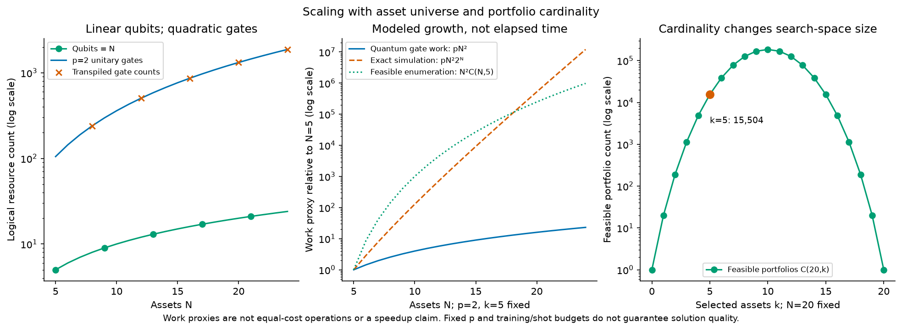
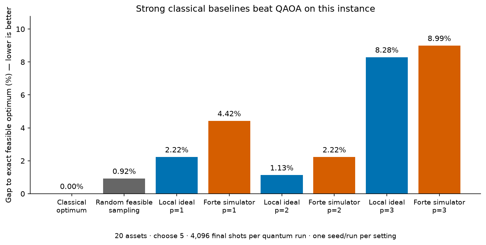
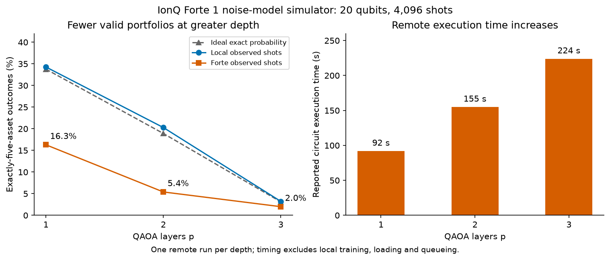

# QAOA Portfolio Optimization

**Team Name**: QuanTech
**Team Members**: Ali Karimi, Ali Mahani, Sabah Ud Din Ahmad

**Theme**: Quantum Impact

**Github**: <https://github.com/themahani/qaoa-portfolio-optimization>

## What is it?

A hybrid quantum–classical portfolio selector built with Qiskit for the
**Quantum Impact** theme. It selects five equally weighted holdings from
nineteen ETFs and Bitcoin, using historical market data to balance expected return
against risk. Every proposed portfolio is checked against the exact answer
and strong classical alternatives.

## Why it matters

Choosing a small portfolio means weighing return, risk and diversification
across many possible asset combinations. Quantum optimization offers a way
to generate candidates without explicitly enumerating every portfolio.
Our project makes that idea testable: it combines a compact quantum encoding,
classical angle training and a reproducible evaluation with real-world data.

The contribution is a runnable benchmark.
Classical heuristics reach the optimum on this instance. We show where
QAOA loses quality, spends training effort and wastes measurements on invalid
portfolios, giving future implementations concrete targets for improvement.

Currently, a great portion of the shots don't reach a valid answer as shown in the figres below.
This will be overcome when fault-tolerant quantum computing is achieved.

## Who is it for?

This is a research example that can be used by **quantitative researchers** and **portfolio managers**. The techniques used
in this project are standard practice in quantitative research.

## How the quantum part works

Each asset is one qubit. A measured **1** selects it; **0** leaves it out.
The portfolio objective and a five-holding penalty become an Ising
Hamiltonian. QAOA alternates a cost layer, which changes phases according to
that objective, with a mixer that changes candidate amplitudes. A classical
optimizer learns the angles locally; Qollab runs the frozen circuit once
and scores its measured portfolios.

**The architectural advantage is compact encoding:** $N$ assets require exactly
$N$ qubits, with no ancillary register in this implementation. The state space
contains $2^N$ possible selections, but a measurement returns only one selection;
it does not reveal or score all portfolios at once. This is a resource property,
not evidence of computational speedup.

### Resource scaling, checked by transpilation

We compiled the trained circuits into the universal gate set **Hadamard (H),
RZ rotations and controlled-NOT (CX)**, with no routing and optimization level
zero. These are logical gate counts, not IonQ native-gate counts.

| QAOA layers | Qubits | H gates | RZ gates | CX gates | Total unitary gates |
| ----------- | -----: | ------: | -------: | -------: | ------------------: |
| 1           |     20 |      60 |      230 |      380 |                 670 |
| 2           |     20 |     100 |      460 |      760 |               1,320 |
| 3           |     20 |     140 |      690 |    1,140 |               1,970 |

For $N$ assets and $p$ layers, **qubits scale as $\mathcal{O}(N)$** and the dense circuit's
**gate work scales as $\mathcal{O}(pN^2)$**. The penalty couples every asset pair, so linear
qubit scaling does not mean linear runtime. With $S$ shots, quantum gate work
is $\mathcal{O}(SpN^2)$; actual latency depends on parallelism, backend compilation and
execution. Local exact statevector training instead has an exponential
$\mathcal{O}(pN^2 2^N)$ per-evaluation upper bound. QAOA has no established speedup here.

See the [resource analysis](docs/resource_analysis.md) for the decomposition,
training costs and reproducible scaling check.



The left panel checks the gate formula against transpilation. The middle
compares growth functions, each normalized to its own value at $N=5$. The right shows why $k$ matters: with twenty
assets there are 15,504 five-asset portfolios, but 184,756 ten-asset portfolios.
At fixed $p$, our dense gate count does not change with $k$; the penalty angles,
feasibility and optimization difficulty can. Fixed-$k$ enumeration is polynomial
in $N$, so these curves do not establish a quantum speedup.

### What we measured

All methods use the same 2015–2020 estimates and equal investment weights.
Each quantum result below uses 4,096 shots. Lower objective cost is better;
only valid five-asset portfolios count.

| Method                                            | Best feasible cost | Gap to optimum | Observed feasible rate | Remote execution time |
| ------------------------------------------------- | -----------------: | -------------: | ---------------------: | --------------------: |
| Classical exact / rounding / greedy / swap search |          -0.028756 |             0% |        Feasible output |                     — |
| Classical random feasible sampling                |          -0.028492 |          0.92% |                   100% |                     — |
| Local ideal QAOA, $p=2$                           |          -0.028432 |          1.13% |                  20.3% |                     — |
| IonQ Forte 1 simulator, $p=1$                     |          -0.027485 |         ≈4.42% |                  16.3% |                  92 s |
| IonQ Forte 1 simulator, $p=2$                     |          -0.028117 |         ≈2.22% |                   5.4% |                 155 s |
| IonQ Forte 1 simulator, $p=3$                     |          -0.026171 |         ≈8.99% |                   2.0% |                 224 s |

Remote times exclude loading, queueing and local training. These are
**noise-model simulator runs**. They used 20 qubits on
a simulator with a 29-qubit capacity. One run per setting does not establish
a statistical advantage. [Full results and backtest](docs/results.md).



Depth two found the best quantum candidate in both environments, but even
random feasible sampling achieved a smaller gap in this experiment. The
figure compares final candidates; quantum training costs are additional.



More layers cost more time without consistently improving the portfolio.
The noisy simulator returned fewer valid samples than the ideal reference
at each depth. These single-run measurements motivate a constraint-preserving
mixer; they do not isolate noise effects or provide repeated-run statistics.

## How do I run it?

Open the project, select a **free simulator**, and run with `shots=4096` and
`depth=1`, `2` or `3` (default: `2`). The demo submits one circuit as one job,
then prints selected assets, costs and the classical comparison.

The three depths have been run successfully on Qollab's free **IonQ Forte 1
simulator**. For local reproduction:

```bash
uv sync
uv run python scripts/bench_classical.py
uv run python scripts/train_qaoa.py
uv run python scripts/analyze_resources.py
uv run python scripts/make_figures.py
uv run pytest
```

**Dependencies:** Python 3.14, Qiskit and NumPy for the demo; Aer and SciPy
for local training, pandas and requests for data, matplotlib for figures.
Local versions are recorded in `pyproject.toml` and `uv.lock`.

## License

Code and documentation are [MIT licensed](LICENSE).

## Disclosures

### AI assistance

Code and documentation were developed with OpenCode AI assistance. The LLM used is _OpenAI GPT-6.1 Sol Fast_.

### Code and dependency licenses

Our source code and documentation are MIT licensed. Direct dependencies are
Qiskit and Qiskit Aer (Apache-2.0), NumPy, SciPy and pandas (BSD-3-Clause),
requests (Apache-2.0), matplotlib (its PSF-based license), pytest (MIT), and
hatchling (MIT). Dependency licenses and notices remain applicable; see each
distribution for the authoritative terms. `uv.lock` records resolved versions.
We do not claim to have audited every transitive dependency.

Local fetching, optimization and tests use libraries that the Qollab demo
does not directly import. The demo uses Qiskit and NumPy from source-tree
imports, without an editable install or `uv` on Qollab.

### Data provenance and rights

Yahoo Finance's public chart endpoint supplied daily adjusted close prices
for the twenty tickers listed in the README over 2015–2024. Monthly simple
returns, metadata and optimization results are derived from those prices.

### Methods and prior work

The methods are standard: Markowitz mean–variance selection, binary-to-Ising
mapping, QAOA, continuous relaxation, enumeration and swap local search.
Background references include Markowitz, “Portfolio Selection” (1952), and
Farhi, Goldstone and Gutmann, “A Quantum Approximate Optimization Algorithm,”
arXiv:1411.4028 (2014). These are background references, not claims that the
implementation reproduces a particular published benchmark. No claim of
first-of-its-kind implementation is made.

This project was created separately from the team's QRC project during this
hackathon session. Local simulation results are not quantum hardware results.
Successful Qollab execution must be verified separately. This is a research
prototype, not investment advice or evidence of quantum advantage.

This effort is supported by Qollab & IonQ.

### Attribution

This project was created during the Qollab x IonQ Hackathon 2026, and is supported by Qollab & IonQ.
