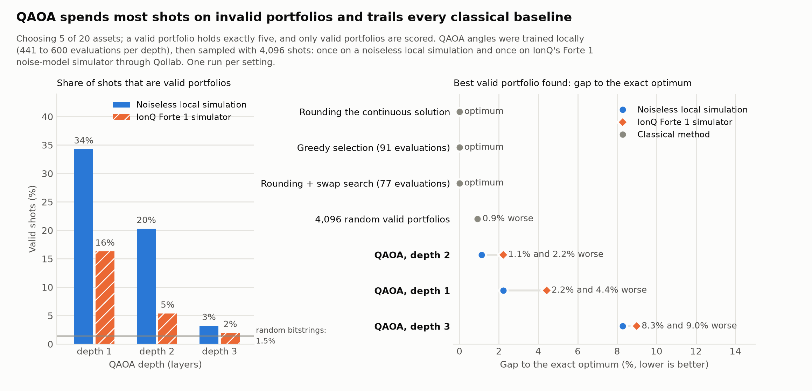

# QAOA Portfolio Optimization

A Qiskit prototype for selecting five equally weighted assets from a
twenty-asset universe. Built for the Qollab × IonQ hackathon's Quantum Impact
theme. We report classical wins and invalid quantum samples explicitly.

**Theme:** Quantum Impact · **Code and documentation license:** MIT

## What is it?

This project chooses five assets from nineteen ETFs and Bitcoin, invests 20%
in each, and compares the resulting risk–return objective across classical
methods and a twenty-qubit quantum circuit. Each measured bitstring represents
a portfolio. We score only portfolios that actually select five assets.

The project includes exact classical ground truth, several inexpensive
classical heuristics, locally trained QAOA circuits, successful Qollab runs
on the free IonQ Forte 1 simulator, and a retrospective held-out backtest.

## Why does it matter?

Portfolio selection is a practical finance problem, but a quantum method is
only useful if its results survive a fair comparison. An apparent quantum
win in our first implementation disappeared after correcting unequal
investment budgets and the treatment of invalid samples.

The corrected experiment is an openly reproducible example of how to test
such claims: use the same objective, include strong classical competitors,
count invalid samples, and report training costs separately from final shots.
Here, classical rounding and greedy selection already reach the exact
optimum. Our contribution is the evaluation and measured limitations, not
a claim of quantum advantage or an investment recommendation.

## How does the quantum part work?

One qubit represents each asset: a measured one selects it, and a zero leaves
it out. We encode estimated portfolio variance, expected return and a penalty
for selecting other than five assets as a quadratic binary objective, then
map that objective to an Ising Hamiltonian.

QAOA starts with Hadamard gates and alternates two operations. A cost layer
uses `RZ` and `RZZ` rotations to apply phases determined by the portfolio
objective. An `RX` mixer changes the amplitudes of candidate selections.
The layer count is the parameter `depth`, with tested values 1, 2 and 3.

A classical COBYLA optimizer tunes the circuit angles locally using ideal
Aer expectations. On Qollab, those frozen angles are loaded and one circuit
is submitted as one job. Its measured portfolios are scored classically
against the saved exact answer. Training does not run on Qollab. The mixer
does not preserve cardinality, so invalid samples are counted and excluded
from the portfolio-cost comparison.

## How to run it

### On Qollab: no installation or uv required

1. Open the published Qollab project. **Public project link: pending.**
2. Select a free simulator. The reported runs used **IonQ Forte 1 simulator**,
   not the credit-consuming hardware option.
3. Use `shots=4096` and choose `depth=1`, `2` or `3` (default: `2`).
4. Run the project. It submits one circuit, then prints feasible portfolios,
   objective scores, feasibility rate and the saved classical comparison.

| Parameter | Meaning | Default |
| --- | --- | --- |
| `shots` | Number of measured outcomes | 4,096 |
| `depth` | Number of QAOA layers; tested values are 1, 2 and 3 | 2 |

Reported Forte 1 simulator execution times were 92 s, 155 s and 224 s for
depths 1, 2 and 3. Loading and queueing may add time. Missing feasible samples
are reported explicitly rather than treated as valid portfolio results.

For the project owner: upload `main.py`, the `src/` tree and
`demo/qaoa_demo.json`, with the runtime dependency declaration in
`requirements.txt`. Qollab calls `main()`; it need not install this repository
as a Python package.

### Locally: reproduce data, training and comparisons

Python 3.14 is required. Clone the repository and run these commands from its
root directory using uv:

```bash
uv sync
uv run python scripts/pull_data.py
uv run python scripts/bench_classical.py
uv run python scripts/train_qaoa.py --depths 1 2 3 --restarts 3 --maxiter 200
uv run python scripts/backtest.py
uv run pytest
```

The Yahoo snapshot can change on refetch. Seeded random starts and sampling
aid reproduction; floating-point/platform differences can affect optimization.

## Demo video

**Public 2–3 minute demo-video link: pending.**

The recording should show the problem, a free-simulator Qollab run, how to
read the output, and the conclusion that classical methods win this instance.
A recording outline is available in [the video script](docs/video_script.md).
The script is not a video; add the recording URL and verify that it opens
without signing in before submitting.

## Dependencies

Qollab's entry point directly uses Qiskit and NumPy. Fetching, training,
plotting and testing are local workflows, not requirements to run the demo.

| Dependency | Version declaration | Purpose |
| --- | --- | --- |
| Python | `>=3.14,<3.15` | Local runtime, matching Python 3.14 |
| Qiskit | `>=2.5.2,<3.0.0` | Circuit construction and execution |
| NumPy | `>=1.26` locally; supplied by Qollab | Portfolio scoring and numerical arrays |
| Qiskit Aer | `==0.17.2` | Local ideal simulation and training |
| SciPy | `>=1.12` | Local continuous relaxation and COBYLA optimization |
| pandas | `>=2.0` | Local data preparation and loading |
| requests | `>=2.31` | Local Yahoo Finance data fetching |
| matplotlib | `>=3.8` | Local result figures |
| pytest | `>=9.1.1`, development group | Automated tests |
| hatchling | Build backend | Local package installation |

`pyproject.toml` declares local dependencies; `uv.lock` records resolved
versions. `requirements.txt` declares the Qollab Qiskit dependency. License
and provenance details are in [DISCLOSURES.md](DISCLOSURES.md).

## Before you submit

- [x] Runs on a free Qollab simulator: participant-reported Forte 1 runs at
  depths 1, 2 and 3, with 4,096 shots each.
- [ ] Confirm the project is public on Qollab under MIT and add its public URL.
  The public GitHub repository alone does not satisfy this requirement.
- [x] Write-up explains what it is, why it matters, how the quantum part works
  and how to run it.
- [ ] Add a 2–3 minute demo-video URL and verify access without signing in.
- [x] Dependencies are listed.

Source code and documentation use [the MIT license](LICENSE). Market-data
rights are separate. The unchecked items remain submission tasks, not verified
claims of publication or video availability.

## Investment model and data

Select exactly k=5 assets, each with weight 1/k. Minimize
`q * x.T @ covariance @ x / k**2 - mean @ x / k` with q=0.5.
The QUBO adds `A * (sum(x)-k)**2`. Moments use monthly **simple** adjusted-price
returns, not weighted log returns.

The universe is SPY, QQQ, IWM, DIA, XLK, XLF, XLV, XLE, XLI, XLP, XLU,
TLT, LQD, HYG, GLD, USO, EFA, EEM, VNQ and BTC-USD. Treasury and gold
correlations are not assumed negative. USO tracks oil futures, not spot oil.
BTC trades on weekends; the daily panel carries ETF closes across those
dates. Monthly returns use each month's last available close.

Files are individually below 2,000,000 bytes. Price data covers 2015–2024.
Train moments on 2015–2020; reserve 2021–2022; backtest only on 2023–2024.
No configuration is currently selected using the reserved interval.
The universe and experiment were designed after inspecting historical data;
this split is an exploratory retrospective test, not a preregistered study.

## Results

All optimization rows use the same twenty-asset universe, five selected
assets, equal investment weights, q=0.5, and 2015–2020 training estimates.
**Lower objective cost is better; objective costs are not investment returns.**
Only feasible portfolios enter the cost comparison. The relative gap is
`100 * (cost - exact_cost) / abs(exact_cost)`.



### Optimization: classical, local QAOA and IonQ simulator

| Method | Execution environment | Candidate budget | Best feasible cost | Gap to optimum |
| --- | --- | --- | ---: | ---: |
| Exact enumeration | Local NumPy | 1,048,576 binary states | -0.028756 | 0.00% |
| Exact feasible enumeration | Local NumPy | 15,504 five-asset portfolios | -0.028756 | 0.00% |
| Continuous relaxation + rounding | Local SciPy | One solve + rounding | -0.028756 | 0.00% |
| Greedy selection | Local NumPy | 91 objective evaluations | -0.028756 | 0.00% |
| Random starts + swaps | Local NumPy | 16 starts; 6,032 objective evaluations | -0.028756 | 0.00% |
| Rounding + swaps | Local NumPy | One start; 77 objective evaluations | -0.028756 | 0.00% |
| Random feasible sampling | Local NumPy | 4,096 feasible candidates | -0.028492 | 0.92% |
| QAOA p=1 | Local ideal Aer + seeded sampling | 4,096 shots after training | -0.028117 | 2.22% |
| QAOA p=2 | Local ideal Aer + seeded sampling | 4,096 shots after training | -0.028432 | 1.13% |
| QAOA p=3 | Local ideal Aer + seeded sampling | 4,096 shots after training | -0.026374 | 8.28% |
| QAOA p=1 | Qollab → IonQ Forte 1 noise-model simulator | 4,096 shots; frozen local angles | -0.027485 | ≈4.42% |
| QAOA p=2 | Qollab → IonQ Forte 1 noise-model simulator | 4,096 shots; frozen local angles | -0.028117 | ≈2.22% |
| QAOA p=3 | Qollab → IonQ Forte 1 noise-model simulator | 4,096 shots; frozen local angles | -0.026171 | ≈8.99% |

The IonQ costs were printed to six decimal places; their gaps are therefore
approximate. These are **remote simulation results, not quantum hardware runs**.
The selected backend's advertised capacity was 29 qubits; our circuit used
20 qubits, not 29.

The optimum is **SPY, QQQ, DIA, XLK, BTC-USD**, with 20% invested in each.
Several inexpensive classical methods reach it. Random feasible sampling
beats all three local QAOA depths and all three reported remote runs in these
single-seed/single-run comparisons. No speedup or quantum advantage is claimed.
The earlier claim of beating rounding used inconsistent capital scaling and
included infeasible samples; it is withdrawn.

### Feasibility and execution cost

Local training used three COBYLA restarts with up to 200 evaluations per
restart. Exact feasible probabilities come from ideal statevectors; observed
rates come from 4,096 sampled outcomes. These are different quantities.

| Run | Exact ideal feasible probability | Observed feasible rate | Circuit depth | RZZ gates before backend compilation | Local training evaluations | Local training time | Reported remote circuit execution time |
| --- | ---: | ---: | ---: | ---: | ---: | ---: | ---: |
| Local p=1 | 33.8% | 34.3% | 41 | 190 | 441 | 205.4 s | — |
| Local p=2 | 18.9% | 20.3% | 63 | 380 | 600 | 478.1 s | — |
| Local p=3 | 3.1% | 3.2% | 85 | 570 | 600 | 604.7 s | — |
| IonQ Forte 1 simulator p=1 | 33.8% ideal reference only | 16.3% | 41 | 190 | Reused local p=1 angles | No retraining on Qollab | 92.0 s |
| IonQ Forte 1 simulator p=2 | 18.9% reference; not a remote probability estimate | 5.4% | 63 | 380 | Reused local p=2 angles | No retraining on Qollab | 155.0 s |
| IonQ Forte 1 simulator p=3 | 3.1% ideal reference only | 2.0% | 85 | 570 | Reused local p=3 angles | No retraining on Qollab | 224.0 s |

Each remote run retained fewer valid portfolios than its local ideal
counterpart: 16.3% versus 34.3% at p=1, 5.4% versus 20.3% at p=2, and 2.0%
versus 3.2% at p=3. The remote p=2 run had the best sampled objective, while
p=1 was fastest and had the highest feasible rate. Increasing depth did not
monotonically improve solution quality. IonQ's remote simulator applies
a device noise model, whereas the local reference is ideal. One run per depth
does not isolate the effects of noise, compilation and sampling. Raw counts
and backend characterization were not supplied with the pasted output.

The 92.0, 155.0 and 224.0 s values are Qollab's reported circuit execution
times (92,000, 155,000 and 224,000 ms for p=1, p=2 and p=3),
not total elapsed time including package loading, initialization or queueing.
They also exclude the corresponding local angle training. Classical enumeration
took approximately 0.59 s; greedy objective scoring took approximately
0.40 ms in the saved local benchmark. These are different computations and
indicative timings, not a controlled cross-platform runtime comparison.
A classical objective evaluation is not cost-equivalent to a simulator
expectation evaluation or a shot.

### Best feasible portfolios

| Result | Selected assets, each at 20% | Objective cost |
| --- | --- | ---: |
| Exact / rounding / greedy / swap-search optimum | SPY, QQQ, DIA, XLK, BTC-USD | -0.028756 |
| Random feasible sampling | SPY, QQQ, XLK, XLV, BTC-USD | -0.028492 |
| Local QAOA p=1 | QQQ, DIA, XLK, XLU, BTC-USD | -0.028117 |
| Local QAOA p=2 | SPY, QQQ, XLK, XLF, BTC-USD | -0.028432 |
| Local QAOA p=3 | SPY, XLK, XLV, EEM, BTC-USD | -0.026374 |
| IonQ Forte 1 simulator QAOA p=1 | QQQ, XLK, XLI, TLT, BTC-USD | -0.027485 |
| IonQ Forte 1 simulator QAOA p=2 | QQQ, DIA, XLK, XLU, BTC-USD | -0.028117 |
| IonQ Forte 1 simulator QAOA p=3 | SPY, QQQ, IWM, EEM, BTC-USD | -0.026171 |

The remote p=2 winner happens to equal the local p=1 winner; those are separate
runs of different trained circuits, not duplicated measurements.

### Top five feasible portfolios from each reported IonQ run

**p=1 — 4,096 shots, 92.0 s reported execution time**

| Rank | Selected assets | Objective cost | Observed shots |
| --- | --- | ---: | ---: |
| 1 | QQQ, XLK, XLI, TLT, BTC-USD | -0.027485 | 1 |
| 2 | QQQ, XLK, XLF, HYG, BTC-USD | -0.027214 | 1 |
| 3 | QQQ, XLK, XLP, LQD, BTC-USD | -0.027075 | 1 |
| 4 | SPY, QQQ, XLF, XLV, BTC-USD | -0.026536 | 1 |
| 5 | SPY, DIA, XLK, LQD, BTC-USD | -0.026354 | 1 |

**p=2 — 4,096 shots, 155.0 s reported execution time**

| Rank | Selected assets | Objective cost | Observed shots |
| --- | --- | ---: | ---: |
| 1 | QQQ, DIA, XLK, XLU, BTC-USD | -0.028117 | 1 |
| 2 | QQQ, XLK, XLU, EEM, BTC-USD | -0.027350 | 1 |
| 3 | QQQ, XLK, XLV, VNQ, BTC-USD | -0.027151 | 1 |
| 4 | QQQ, XLK, XLU, TLT, BTC-USD | -0.027088 | 1 |
| 5 | QQQ, XLK, LQD, EEM, BTC-USD | -0.026864 | 1 |

**p=3 — 4,096 shots, 224.0 s reported execution time**

| Rank | Selected assets | Objective cost | Observed shots |
| --- | --- | ---: | ---: |
| 1 | SPY, QQQ, IWM, EEM, BTC-USD | -0.026171 | 1 |
| 2 | QQQ, IWM, XLF, EEM, BTC-USD | -0.025734 | 1 |
| 3 | QQQ, XLI, XLP, GLD, BTC-USD | -0.025510 | 1 |
| 4 | QQQ, XLI, LQD, GLD, BTC-USD | -0.024974 | 1 |
| 5 | SPY, IWM, XLF, XLV, BTC-USD | -0.024922 | 1 |

These are ranked by objective cost, not sampling frequency. Each appeared
once, so the tables do not establish stable portfolio-selection probabilities.

### Retrospective held-out backtest: 2023–2024

Frozen portfolios are rebalanced monthly to equal weights, with 10 basis
points charged per absolute weight traded, including initial investment from
cash. Return is cumulative over two years; volatility is annualized and
drawdown is measured at monthly observation points.

| Portfolio source | Net cumulative return | Annualized volatility | Maximum drawdown | Total absolute weight turnover |
| --- | ---: | ---: | ---: | ---: |
| Classical exact / rounding / greedy / swap-search optimum | 121.31% | 18.77% | -6.81% | 1.914 |
| Random feasible sampling | 111.53% | 18.06% | -6.84% | 1.942 |
| Local QAOA p=1 | 108.68% | 18.28% | -7.67% | 2.004 |
| Local QAOA p=2 | 126.01% | 18.84% | -6.69% | 1.940 |
| Local QAOA p=3 | 91.26% | 17.57% | -6.90% | 1.991 |

No separate remote backtests were run. The remote p=2 winner is identical
to the local p=1 portfolio, so the existing local p=1 backtest describes that
same allocation—not an independently measured IonQ investment result.
The remote p=1 and p=3 winners differ from the local winners and have not
been backtested in the saved results.
The local p=2 portfolio's higher realized return does not establish quantum
advantage: this is one exploratory historical split and one sampling seed.
These results are not investment advice.

### Result provenance

- `data/classical_baseline.json`: classical scores, selected assets, budgets
  and local timings.
- `demo/qaoa_demo.json`: ideal local probabilities, frozen angles, training
  costs and seeded local sampling results. It does **not** contain IonQ counts.
- `data/backtest.json`: retrospective portfolio-performance calculations.
- `data/ionq_runs.json`: the IonQ Forte 1 simulator runs below, transcribed
  from the Qollab console output. `scripts/make_figures.py` draws the figure
  from this file and `demo/qaoa_demo.json`; alt text is in `docs/figures/`.
- IonQ Forte 1 simulator rows: participant-provided Qollab output from the
  successful p=1, p=2 and p=3 runs, each with 4,096 shots. The display identified the backend as
  `ionq_simulator`; the participant identified the selected option as Forte 1.

## Qollab verification

A participant successfully ran the p=1, p=2 and p=3 demos on Qollab's IonQ
Forte 1 simulator with 4,096 shots each; their results are included above.
This verifies those reported configurations, not every backend or setting.
After publishing the final version, verify it again from another account or
a logged-out browser.

## Documentation and rights

[Criterion write-up](docs/criterion_summary.md) · [Project page text](docs/project_page.md) ·
[Video script](docs/video_script.md) · [Disclosures](DISCLOSURES.md).
Code and documentation are MIT licensed. Market-data redistribution rights
are separate and have not been established by the code license.

This effort is supported by Qollab & IonQ.
